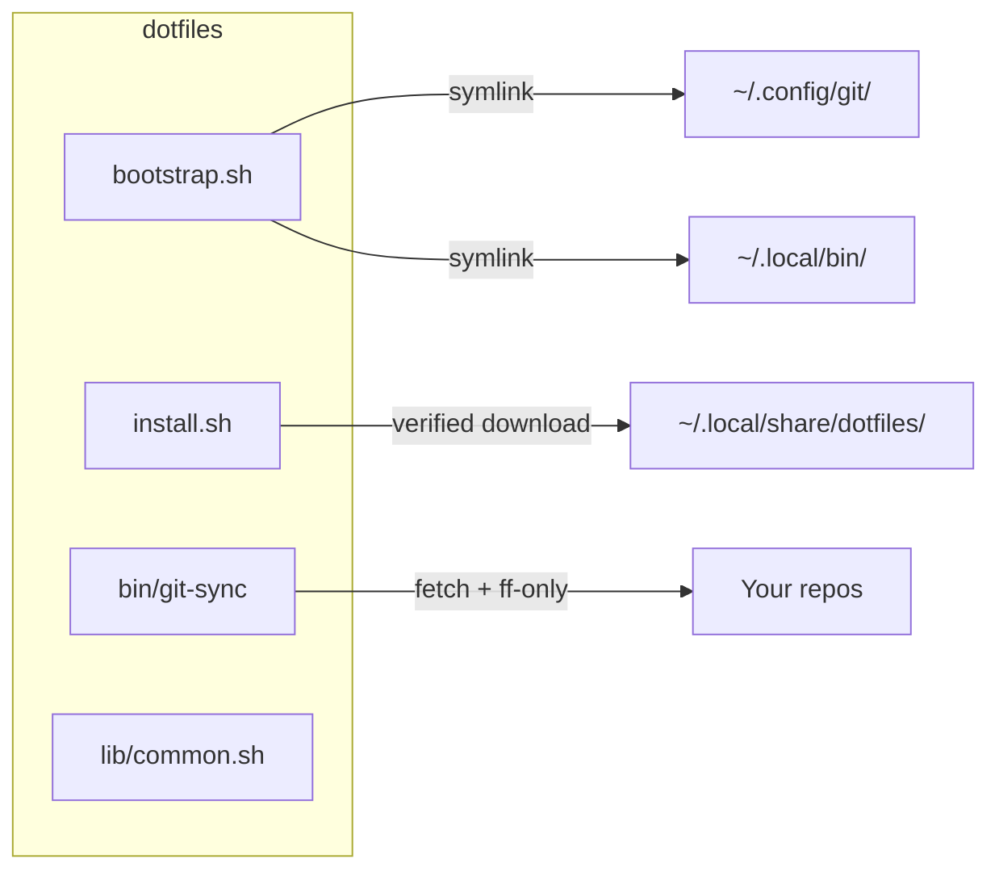

# dotfiles

Safe, opt-in git defaults: global config layer, hooks that chain to repo hooks, and `git sync` (fast-forward-only branch syncer).



## Quickstart

```sh
git clone https://github.com/tyler-jewell/dotfiles ~/dotfiles
cd ~/dotfiles
./bootstrap.sh --dry-run        # preview
./bootstrap.sh                  # apply (backups created)
./bootstrap.sh --check          # doctor
export PATH="$HOME/.local/bin:$PATH"
./bootstrap.sh --uninstall      # remove everything, restore backups
```

## Profiles

Set `[dotfiles] profile = ...` in `~/.config/dotfiles/config`. Default: `standard`.

| Feature | minimal | standard | strict | What |
|---------|---------|----------|--------|------|
| `secretScan` | ✓ | ✓ | ✓ | pre-commit: secrets, .env files, >5MB files |
| `conventionalCommits` | | ✓ | ✓ | commit-msg: Conventional Commits |
| `sync` | | ✓ | ✓ | post-commit/checkout/merge: background fetch |
| `branchName` | | | ✓ | pre-push: branch must match pattern |
| `protectMain` | | | ✓ | pre-push: no direct push to main/master |

Any feature can be forced on/off per repo: `git config --local hooks.secretScan false`

## Secrets

Pre-commit blocks `.env`/`.env.*` files. Commit `op://` references instead:

```sh
# op.refs (safe to commit)
API_TOKEN=op://example-vault/example-item/field
op run --env-file=op.refs -- ./my-command
```

## Exempt repos

```ini
[hooks]
    exemptOrigins = *github.com/acme-corp/*
```

Globs match every remote URL. Per repo: `git config --local hooks.exempt true`.

## git sync

```sh
git sync                   # current repo
git sync --all             # manifest entries with sync=yes
git sync --root ~/code     # all repos under ~/code
git sync --prune-merged    # delete merged gone branches (bundle backup first)
```

States: `up-to-date | fast-forwarded | behind-skipped-dirty | ahead | diverged | gone | no-upstream | pruned`. Exit: 0 ok, 2 attention, 3 fetch error, 64 usage.

## Compatibility

macOS `/bin/bash` 3.2 (tested), Linux bash 4/5 (CI), git >= 2.35, Windows (WSL). Optional: `gitleaks`, `jq`.

## More

[Threat model](docs/THREAT-MODEL.md) | [Adopting](docs/ADOPTING.md) | [Git config](docs/GIT-CONFIG.md) | [FAQ](docs/FAQ.md) | [Contributing](CONTRIBUTING.md) | [Changelog](CHANGELOG.md)

Tests: `bash tests/run.sh`. Apache-2.0.